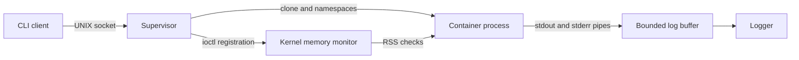

# Jackfruit: Linux Container Runtime

A C systems project that combines a multi-container supervisor, namespace-based process isolation, concurrent log collection, and a Linux kernel memory monitor.

**Stack:** C · Linux namespaces · pthreads · UNIX domain sockets · kernel modules · Make

[Source](boilerplate) · [Project guide](project-guide.md) · [Companion final submission](https://github.com/sidd2006/OS-Jackfruit-FINAL)

## Engineering highlights

- PID, UTS, and mount namespaces with a separate root filesystem.
- A supervisor and CLI for starting, listing, inspecting, and stopping containers.
- Pipes and a bounded producer/consumer buffer for log collection.
- UNIX-domain-socket control requests.
- A kernel module for monitoring resident memory and applying soft/hard thresholds.
- CPU and I/O workloads for exploring scheduling behavior.

## Architecture



## Build requirements

Use a Linux development VM with matching kernel headers and permission to load the module. The full runtime and module demonstrations require root.

```bash
git clone https://github.com/sidd2006/OS-Jackfruit.git
cd OS-Jackfruit
sudo apt update
sudo apt install -y build-essential linux-headers-$(uname -r) wget
```

Build the user-space targets without loading a kernel module:

```bash
make -C boilerplate ci
```

Build the runtime, static workload binaries, and module:

```bash
make -C boilerplate all
```

The full build requires a toolchain with static-link support for the workload binaries. The CI target uses dynamic linking and only checks the user-space build.

## Prepare the root filesystem

Run from the repository root:

```bash
cd boilerplate
mkdir -p rootfs-base
wget https://dl-cdn.alpinelinux.org/alpine/v3.20/releases/x86_64/alpine-minirootfs-3.20.3-x86_64.tar.gz
tar -xzf alpine-minirootfs-3.20.3-x86_64.tar.gz -C rootfs-base
cp -a rootfs-base rootfs-alpha
cp cpu_hog memory_hog io_pulse rootfs-alpha/
```

## Run a demonstration

Load the monitor and start the supervisor from `boilerplate/`:

```bash
sudo insmod monitor.ko
sudo ./engine supervisor ./rootfs-base
```

In another terminal, also inside `boilerplate/`:

```bash
sudo ./engine start alpha ./rootfs-alpha /cpu_hog --soft-mib 48 --hard-mib 80
sudo ./engine ps
sudo ./engine logs alpha
sudo ./engine stop alpha
```

The CLI also provides `run` and a `--nice` option. Inspect the usage output in [engine.c](boilerplate/engine.c) and the [project guide](project-guide.md) for the full interface.

Stop the supervisor with Ctrl+C, then unload the module:

```bash
sudo rmmod monitor
```

## Repository guide

| File | Purpose |
| --- | --- |
| [engine.c](boilerplate/engine.c) | Supervisor, CLI, isolation, IPC, and logging |
| [monitor.c](boilerplate/monitor.c) | Kernel memory-monitor implementation |
| [monitor_ioctl.h](boilerplate/monitor_ioctl.h) | User/kernel interface |
| [cpu_hog.c](boilerplate/cpu_hog.c) | CPU workload |
| [memory_hog.c](boilerplate/memory_hog.c) | Memory-pressure workload |
| [io_pulse.c](boilerplate/io_pulse.c) | I/O-oriented workload |
| [environment-check.sh](boilerplate/environment-check.sh) | Environment inspection helper |

## Scope and tradeoffs

This educational runtime runs trusted workloads. It shares the host kernel and network stack and uses `chroot`; it is not a hardened sandbox. Nice values influence scheduling priority rather than enforcing CPU quotas. The memory monitor samples RSS rather than providing comprehensive cgroup-style resource accounting.

## Team

Siddhant Khurdiya (PES1UG24AM275) and Shubham Dattatraya Bhat (PES1UG24AM273). The repository retains the course project scaffold and guide.
